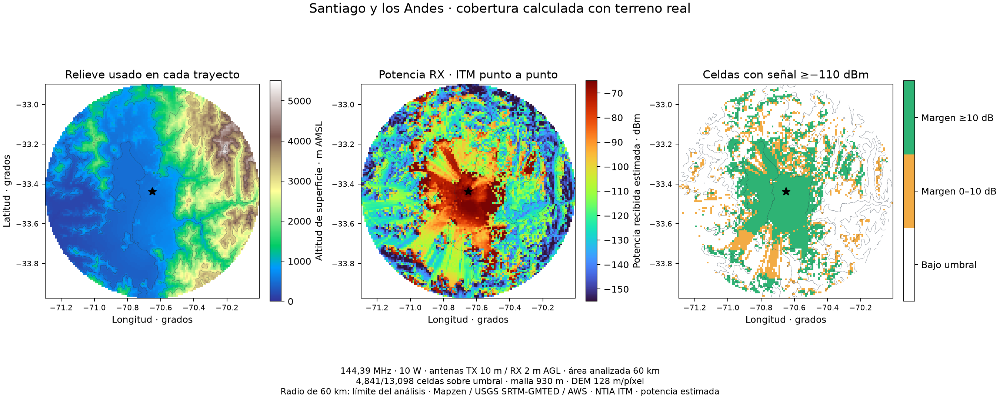

# Cobertura VHF/UHF con terreno · 0.8.9

La cobertura se calcula ahora como una **malla de enlaces punto a punto independientes**. Cada celda usa un perfil DEM completo desde TX hasta el receptor situado en esa celda y llama al código NTIA ITM. Se conservan los valles sin señal, las sombras detrás de crestas y los puntos altos donde la señal vuelve a superar el umbral.

## Problemas encontrados en 0.8.8

1. El mapa dibujaba siempre un círculo de horizonte ideal. La altitud del terreno AMSL se sumaba a las alturas AGL para ese horizonte de Tierra lisa; esto agrandaba indebidamente la referencia en ubicaciones elevadas.
2. La cobertura usaba 32 rumbos y guardaba el punto más lejano favorable en cada uno. Al rellenar hasta ese punto se pintaban también zonas intermedias desfavorables. Entre rumbos separados 11,25°, a 100 km quedaban casi 20 km de terreno sin calcular.
3. Los perfiles se muestreaban cada ~500 m y las distancias cada 5 km. Una cresta estrecha o un valle podía quedar fuera de las muestras.
4. El helper rechazaba el código NTIA `SUCCESS_WITH_WARNINGS` aunque contiene una predicción válida. Esto descartaba trayectos próximos a límites del modelo, incluidos enlaces de montaña.
5. Elegir un destino borraba el resultado del área, impidiendo explorar sus celdas.

## Modelo y alturas

La entrada del usuario es altura de antena **AGL**, sobre el terreno local. Las muestras DEM son altitudes **AMSL**, sobre el nivel del mar. ITM recibe ambas por separado y combina el suelo de cada extremo con su altura estructural; la app no suma el suelo una segunda vez a la entrada AGL.

Ejemplo: terreno TX 600 m + antena TX 10 m = antena a 610 m AMSL. Si RX está en terreno de 1.200 m y tiene antena de 2 m, su extremo queda a 1.202 m AMSL. Las elevaciones de todas las crestas intermedias forman parte del perfil. ITM modela pérdida, difracción y dispersión troposférica; una montaña que interrumpe la vista directa puede aún permitir señal difractada. [Entradas y mecanismos oficiales de NTIA](https://github.com/NTIA/itm).

Potencia recibida: `10 log10(watts × 1000) + ganancia TX + ganancia RX − pérdida ITM`, en dBm. Se compara con el umbral RX introducido; el color expresa margen en dB. No expresa una probabilidad de contacto ni una medición del receptor.

La configuración de la app utiliza N0=301, permitividad=15, conductividad=0,005 S/m, confianza y fiabilidad al 50 %, variabilidad NTIA modo 1, clima elegido y polarización elegida. La curvatura y los horizontes de ITM se calculan internamente. El gráfico de línea directa utiliza k=4/3 como comparación geométrica; no inyecta esa curvatura en el perfil de ITM ni duplica su corrección.

El horizonte de Tierra lisa se calcula solo con AGL. Es una referencia opcional, apagada al abrir el panel; no define el contorno de cobertura ni representa la topografía.

## Relieve y resolución

Se consultan [Mapzen Terrain Tiles alojadas en AWS](https://registry.opendata.aws/terrain-tiles/) en formato [Terrarium](https://github.com/tilezen/joerd/blob/master/docs/formats.md). Se decodifican los valores numéricos RGB sin transformación de color: `R × 256 + G + B/256 − 32768`. Las teselas se interpolan bilinealmente, incluso entre bordes; una muestra ausente nunca se sustituye por terreno plano.

Apple Maps aporta mapa y relieve visual; los valores empleados por ITM vienen del DEM. Las [fuentes regionales de Mapzen](https://github.com/tilezen/joerd/blob/master/docs/data-sources.md) incluyen SRTM, GMTED y otras. La separación entre píxeles no equivale a exactitud vertical ni garantiza que una cresta de ese ancho esté resuelta.

| Resolución | Comportamiento |
|---|---|
| Malla rápida | 65 × 65 celdas, con centros independientes |
| Malla detallada | 129 × 129 celdas; opción inicial |
| Paso de malla | `2 × radio / lado`; ~930 m con radio 60 km y lado 129 |
| DEM inicial | Zoom 11 hasta 50 km de radio; zoom 10 en áreas mayores |
| Presupuesto de descarga | Reduce zoom si supera 128 teselas; se muestra la separación usada |
| Perfil ITM | Muestreo geodésico uniforme al paso del DEM, como mínimo 90 m, hasta 4.097 muestras |
| Área | Radio de análisis 5–200 km, latitudes ±80° |
| Enlace exacto | 1–500 km; corredor de teselas del trayecto, con el mismo motor y caché |

La malla y el DEM tienen resoluciones distintas. Una malla de 930 m no convierte el DEM en un relieve de 930 m: cada enlace atraviesa muestras topográficas más próximas. Sin embargo, una pequeña zona de recepción entre centros puede faltar. Para estudiar un valle o una cresta concretos, reduce el área y calcula el enlace exacto al seleccionar RX.

Un área de análisis sigue limitada por el radio solicitado. El borde exterior puede ser circular porque delimita qué puntos se calcularon; **solo las celdas verdes/ámbar representan potencia sobre umbral**. Si hay celdas favorables en el borde, la app indica que el análisis debe ampliarse para estudiar lo que sigue. No deduce un alcance máximo desde ese corte.

## Mapa e interacción

- Verde: margen ≥10 dB; ámbar: margen 0–10 dB.
- Las celdas bajo umbral son transparentes inicialmente; pueden mostrarse en rojo para inspeccionar sombras.
- Celdas sin DEM, con error ITM, fuera del área o a menos de 1 km no reciben color. Ese vacío no prueba falta de señal.
- Clic en destino: muestra potencia, margen, elevación y avisos de la celda más cercana, manteniendo el área calculada. **Calcular relieve y enlace** obtiene el resultado del punto exacto.
- Cambiar TX, alturas, frecuencia, potencia, ganancias, clima, polarización, umbral, radio o calidad invalida la malla anterior.
- El proceso tiene progreso y cancelación. Un trabajo cancelado o desactualizado no publica una imagen parcial como si estuviera completa.

MapKit dibuja un raster georreferenciado, con filas norte→sur y sin suavizar huecos mediante un polígono envolvente. La llamada C a la biblioteca ITM arm64 evita crear miles de procesos; el cálculo ocurre fuera del actor principal.

## Datos, conexión y atribución

El DEM se descarga únicamente al solicitar el área o enlace. Se envían índices de teselas al servicio AWS, que permiten inferir la región consultada; la app no envía las coordenadas de cada celda ni solicita GPS. Apple Maps mantiene sus propias consultas de mapa. Las teselas PNG se conservan localmente en `Application Support/RadioWorkbench/terrain-tiles`, con hasta cuatro descargas simultáneas y un objetivo de caché de 256 MiB. Una consulta puede funcionar sin conexión si dispone de todas sus teselas.

La fecha de consulta no es la fecha de levantamiento topográfico: este DEM no es una medición en tiempo real. Se acredita Mapzen, USGS SRTM/GMTED, NOAA ETOPO1 y los proveedores regionales; [atribuciones y condiciones de los datos](https://github.com/tilezen/joerd/blob/master/docs/attribution.md). El código NTIA y sus avisos de licencia se incluyen sin cambiar el algoritmo upstream.

## Validación

Se comparó el puente nativo con los **cinco perfiles de referencia publicados por NTIA** en la revisión fijada del proveedor `183ad95bd813a8be11009df396e1c631356864b2`: pérdidas con diferencia inferior a 0,01 dB. Son ejemplos oficiales, no una validación exhaustiva del modelo frente a RF medida. Las fixtures y sus hashes están en `Tests/RadioCoreTests/Fixtures/TerrainReference`.

En la prueba sintética de una cresta de 1.800 m, el trayecto detrás de la montaña dio −143,94 dBm y el opuesto despejado −95,57 dBm: diferencia de **48,37 dB**. La prueba comprueba que la sombra queda vacía al colorear y que una recuperación lejana no rellena un hueco intermedio. También se verifican AGL/AMSL, orientación norte/sur, antimeridiano, caché PNG, avisos, selección de destino y cancelación. Una prueba dibuja el renderizador MapKit en un bitmap y comprueba norte arriba y transparencia del hueco interior. La suite completa ejecutó 109 funciones y omitió por defecto el benchmark opcional, que pasó por separado. [Registro de pruebas](validation/release-0.8.9-tests.txt).

Prueba con geografía real, coordenadas públicas de Santiago centro (−33,4372; −70,6506), radio 60 km, 144,39 MHz, 10 W, TX 10 m AGL, RX 2 m AGL, ganancias 0 dBi y umbral −110 dBm:

| Medida | Resultado |
|---|---|
| Teselas DEM | 36; ninguna ausente |
| Paso DEM en el origen | 127,57 m/píxel |
| Paso de malla | 930,23 m/celda |
| Celdas modeladas | 13.098 |
| Celdas ≥−110 dBm | 4.841 |
| Celdas con avisos NTIA | 7.498; requieren interpretar los límites indicados |
| Altitudes del área | 136,64–5.306,76 m |
| Descarga y cálculo Release en M1 | 6,35 s en esta ejecución; no es una garantía de rendimiento |

Los números describen una simulación, sin ajuste contra contactos reales. Los puntos aislados sobre cumbres son resultados independientes; no se conectan al origen rellenando el valle. Se conservan los avisos NTIA y se explican para el punto seleccionado. [Banderas oficiales](https://github.com/NTIA/itm/blob/master/ERRORS_AND_WARNINGS.md).

[Datos resumidos y hashes de teselas](validation/terrain-santiago-0.8.9-summary.json) · [Malla completa comprimida](validation/terrain-santiago-0.8.9-grid.json.gz).

Reproducción: `RADIO_TERRAIN_BENCHMARK=1 bash script/test.sh --configuration release --filter terrainRealSantiagoBenchmark`. Requiere red o caché; exporta la malla a `/private/tmp/radioworkbench-terrain-benchmark/santiago-coverage.json`. `script/plot_terrain_coverage.py` produce la figura usando NumPy/Matplotlib opcionales; no son dependencias de la aplicación.

## Alcance de la revisión de condiciones

Se revisó la relación entre datos recientes y modelos: NOAA/D-RAP conserva la fecha de observación, HamQSL su fecha y cadencia horaria, las ionosondas su ubicación/fecha y P.533 su carácter mensual. Ninguno se convierte automáticamente en un multiplicador de alcance VHF. El clima ITM es una categoría estadística; no integra ductos o refractividad meteorológica instantánea. Un spot PSK/RBN/APRS tampoco confirma recepción local.

## Comprobación de la aplicación

El paquete arm64 0.8.9/build 21 compiló y abrió. La herramienta CUA devolvió `Sky Computer Use native pipe closed before response` al intentar inspeccionar la ventana de propagación, incluso tras reconectarla. La app permaneció activa y no apareció un informe de cierre nuevo; la inspección visual interactiva de Apple Maps queda pendiente. La prueba fuera de pantalla del renderizador y la figura científica validan orientación y huecos, pero no sustituyen esa revisión de la ventana.

## Límites pendientes

No se modelan edificios, vegetación, pérdidas de cable, patrón direccional real de antena, interferencia, esporádica E o ductos en tiempo real. La interpolación y el muestreo pueden omitir crestas estrechas. Las alturas DEM negativas se llevan a 0 m como aproximación de superficie marina; aún no existe una máscara de agua para distinguir depresiones terrestres bajo el nivel del mar. ITM puede emitir avisos por distancias cortas, ángulos grandes u horizontes fuera de sus aproximaciones; esos resultados se muestran con su aviso, no como precisión garantizada.
